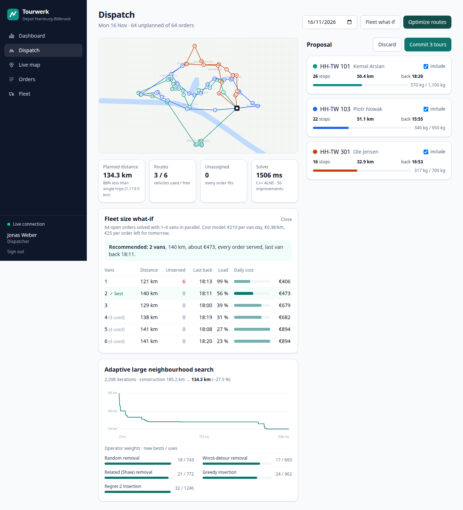
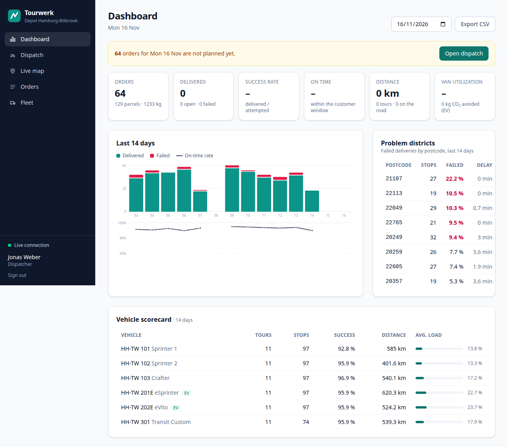
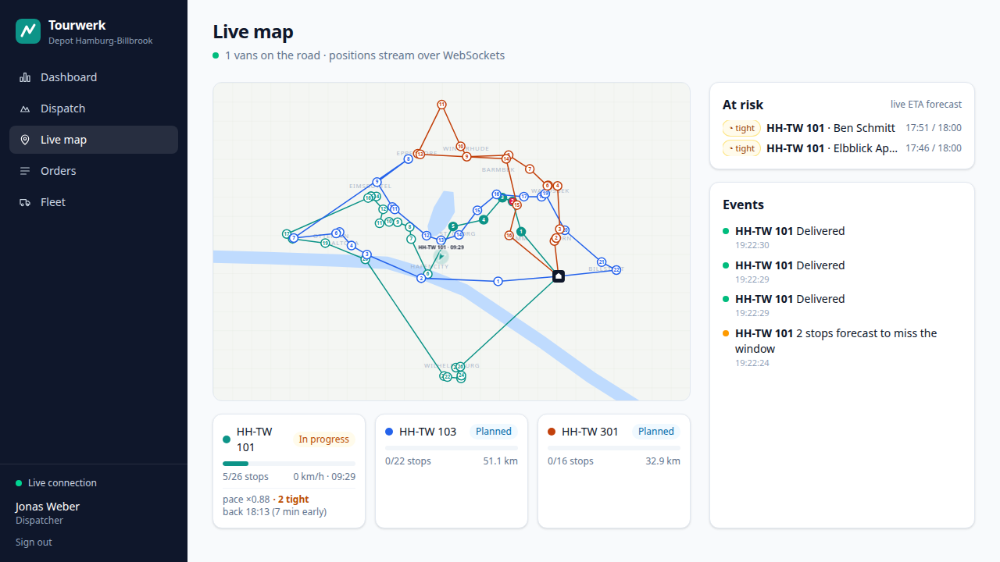
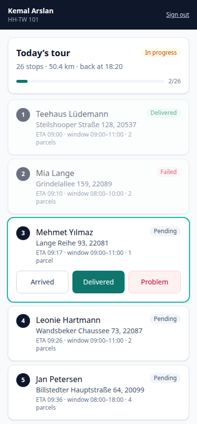

# Tourwerk

**Last-mile delivery dispatch, route optimization and live fleet tracking.**

Tourwerk plans a parcel depot's day. It turns the day's orders into delivery tours with a
C++ route optimizer that respects van capacity, customer time windows and the driver's
shift. It then follows every van live on a map while drivers mark stops as delivered.
Delivered orders flow into the company's legacy ERP. Webshop orders arrive through an
Apache NiFi pipeline.



| Dashboard | Live map | Driver app |
|---|---|---|
|  |  |  |

## Highlights

* **C++17 route optimizer (CVRPTW) with Adaptive Large Neighbourhood Search:**
  Clarke–Wright savings and cheapest insertion build a first solution. ALNS then runs for a
  fixed time budget (default 1.5 s): it ruins part of the plan with *random*, *worst-detour*
  or *related (Shaw)* removal and rebuilds it with *greedy* or *regret-2* insertion. Operators
  are chosen by roulette wheel, their weights adapt to how often they find better plans, and
  simulated annealing with exponential cooling decides acceptance. Insertion feasibility is
  checked without copying routes, so the search manages about 2,000 iterations per solve.
  On the demo day this gives **about 22 % less distance than construction alone and about
  87 % less than single round trips**. The Dispatch page shows the convergence curve and the
  final operator weights. Fixed seed per day, so a run is reproducible when it is given an
  iteration limit. A TypeScript greedy solver takes over if the native binary is missing.
* **Live ETA forecasting and risk alerts:** every GPS fix and stop event re-forecasts the
  rest of each running tour. The pace factor is learned from the stops already completed
  (actual vs. planned) and kept close to 1 while there are few of them. Stops are flagged as
  *tight* (< 15 min slack) or *late* (window will be missed), pushed over Socket.IO as
  `tour:eta` at most once per second per tour, and listed in an "At risk" panel on the Live
  map. It runs as a decorator on the notifier, so the simulator and driver API needed no
  changes.
* **C99 fleet simulator:** one process per tour drives the planned route in accelerated time
  and streams positions and delivery events back to the API. It keeps a service clock, waits
  when it is early for a delivery window, and some legs hit congestion (`SIM_JAM_RATE`), so the
  ETA engine has real delays to detect.
* **Fleet-size what-if:** solves the day's open orders with 1…N vans in parallel native
  processes and compares distance, unserved orders, last return, load and a daily cost
  (van-day + per km + per order left over). It recommends the cheapest fleet size that serves
  every order. Read-only, so dispatchers can compare before they commit.
* **Public delivery tracking for recipients:** a signed link (`<order number>.<HMAC>`, checked
  in constant time) opens a page without an account. It shows a live arrival window
  (forecast ± 15 min), how many stops come first and a progress stepper. The van's position
  is shown only once the recipient is among the next 3 stops. The response leaves out the
  customer name, phone number, other customers and the driver's surname. Rate-limited per IP.
* **Real-time over Socket.IO:** JWT-authenticated rooms. Dispatchers see the whole fleet,
  drivers only their own van. Positions move on the map, events land in a live feed, and
  lists refresh on their own.
* **Safe under concurrency:** two dispatchers committing the same plan → exactly one wins
  (conditional claim inside a transaction, 409 for the other). Stop events are idempotent,
  so driver retries are safe. Order numbers come from a PostgreSQL sequence.
* **Three databases, each for its job:** PostgreSQL + Prisma (core data), MongoDB +
  Mongoose time-series collection (GPS telemetry, 90-day TTL), MySQL (legacy ERP export,
  idempotent upserts). See [docs/QUERIES.md](docs/QUERIES.md) for the data model,
  indexes, `EXPLAIN` plans and concurrency notes.
* **KPIs in SQL:** success rate, on-time rate against the customer window, distance, van
  utilization, CO₂ avoided by the e-vans, 14-day trend, problem districts and a vehicle
  scorecard. Aggregation stays in PostgreSQL (`FILTER`, `generate_series`, CTEs). CSV export.
* **Apache NiFi integration:** a webshop CSV export is converted to JSON and posted to an
  idempotent bulk endpoint with per-row results (`created` / `duplicate` / `rejected`). A
  scheduled ERP export trigger runs alongside it.

## Architecture

```
                 ┌──────────── React 19 · Router · Context · Tailwind 4 (Vite) ───────────┐
                 │  Dashboard · Dispatch · Live map · Orders · Fleet · Driver (mobile)    │
                 └───────────────┬───────────────────────────────▲────────────────────────┘
                          REST /api (JWT)                  Socket.IO (JWT rooms)
                 ┌───────────────▼───────────────────────────────┴────────────────────────┐
  Apache NiFi ──▶│ Express 5 · TypeScript · zod validation · role guards                  │
  (webshop CSV)  │  planning ─ spawn ─▶ tw-optimizer (C++17, ALNS)                        │
                 │  tours    ─ spawn ─▶ tw-tracker   (C99, one per tour) ─ stdout events  │
                 └─────┬──────────────────────────┬───────────────────────────┬───────────┘
                PostgreSQL (Prisma)        MongoDB (Mongoose)            MySQL (mysql2)
                orders · tours · stops     GPS time-series               legacy ERP deliveries
```

## Run it

Requirements: Node 24, g++/gcc/make, PostgreSQL 16 binaries (the dev script starts a private
cluster on port 5442; no system service needed).

```bash
npm install
npm run dev          # builds native tools, starts Postgres, migrates, seeds, runs API (:4600) + web (:5200)
```

Open http://localhost:5200. Every demo account uses the password **`Tourwerk2026!`**:

| Account | Role |
|---|---|
| `dispo@tourwerk.de` | Dispatcher: plan, dispatch, follow the fleet |
| `admin@tourwerk.de` | Admin: also manages vehicles and drivers |
| `fahrer1@tourwerk.de` … `fahrer6@tourwerk.de` | Drivers: mobile tour view |

A good demo: **Dispatch → Optimize routes → Commit**, then **Simulate drive** on a few tours
and watch them on **Live map**. Sign in as `fahrer1@tourwerk.de` in a second window to
deliver stops by hand.

Without MongoDB and MySQL, the API falls back to in-memory adapters (logged at startup). For
the full stack, including MongoDB, MySQL and nginx:

```bash
docker compose up --build                  # http://localhost:8080
docker compose --profile nifi up --build   # adds Apache NiFi on https://localhost:8443
```

## Tests

```bash
npm test        # C++ optimizer tests + C simulator smoke test, API (Jest + Supertest), web (React Testing Library)
npm run e2e     # Playwright: dashboard → optimize & commit → driver app → live simulation → orders
```

* **Native:** feasibility of every route (capacity, windows, shift), every order exactly
  once, beats naive routing by >50 %, impossible orders reported, fleet limit.
* **API (against a real PostgreSQL):** auth and roles, validation, idempotency, plan
  commit (overload refused, three concurrent commits → one wins), driver flow, the C
  simulator end to end, KPI queries, NiFi batch import. Contract tests run the same
  assertions against the MongoDB and MySQL adapters (enabled in CI, where both run as
  services).
* **Web:** login and role redirects, order-form validation (client and server field
  errors), charts and map rendering.
* **CI:** GitHub Actions runs all of the above plus `docker compose build`.

## Project layout

```
apps/api        Express API, Prisma schema + migrations, services, adapters, tests
apps/web        React app (pages, components, contexts), RTL tests
native          C++ optimizer (+ tests) and C fleet simulator, Makefile
e2e             Playwright tests
integration     NiFi flow + sample CSV, MySQL ERP schema, nginx config
docs            data model / query notes, screenshots
```
